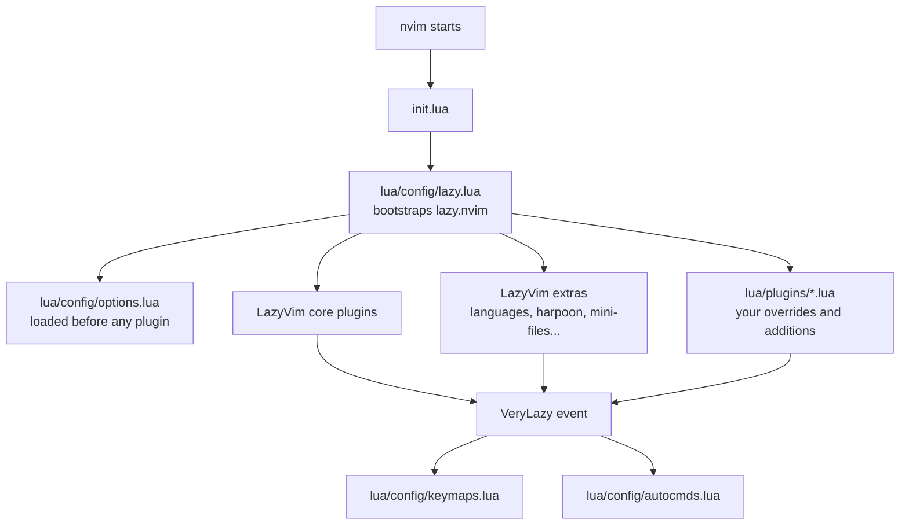

<h3 align="center">One Neovim config for learning Vim and shipping real code.</h3>

<p align="center">
  LazyVim base · Picks from linkarzu's neobean · TypeScript, Vue, Rust, Go, Docker and more<br/>
  <b>A small set of files you own, layered on top of a distribution that does the heavy lifting.</b>
</p>

<p align="center">
  
  
  
  
  
</p>

---

## What this config is

Neovim on its own is a fast editor with almost no opinions. Turning it into a full IDE by hand means picking and wiring up dozens of plugins: a file finder, language servers, completion, git signs, formatting. That's a lot to take on while you're still learning `hjkl`.

This config splits the work in two:

- **[LazyVim](https://www.lazyvim.org)** provides the core features: LSP, completion, the picker, treesitter, git, which-key and sensible defaults. You don't edit it; it updates like any other plugin.
- **Your files** in `lua/config` and `lua/plugins` hold only what differs from LazyVim. Every file is short enough to read in one sitting.

On top of that it adds a few habits that help while learning. **hardtime** blocks lazy `jjjj` spam and suggests a better motion. **which-key** shows what every key does when you pause. Flash's `f`/`t` override is turned off so plain Vim motions stay plain.

The plugin picks and several keymaps come from linkarzu's `neobean` setup. Everything tied to macOS, kitty, tmux or his personal note-taking workflow was left out.

## How it loads



A file in `lua/plugins/` that names a plugin LazyVim already ships **merges** its `opts` into LazyVim's. It doesn't replace them. That's why most files here are only a few lines long.

## Layout

```
~/.config/nvim
├── init.lua                  # One line: require("config.lazy")
├── lazy-lock.json            # Exact plugin commits, written by :Lazy
├── stylua.toml               # Lua formatting, 2 spaces
├── docs
│   └── Kickstart.md          # This file
└── lua
    ├── config
    │   ├── lazy.lua          # lazy.nvim bootstrap and the list of LazyVim extras
    │   ├── options.lua       # Indentation, UI, search
    │   ├── keymaps.lua       # Your keymaps on top of LazyVim's
    │   └── autocmds.lua      # Autosave, and 2-space indent after ftplugins run
    └── plugins
        ├── colorscheme.lua   # eldritch (default), catppuccin, gruvbox
        ├── editor.lua        # flash, hardtime, multi-cursor, stay-centered, grug-far, which-key
        ├── git.lua           # Neogit and Diffview
        ├── lsp.lua           # LSP options, Mason tools, treesitter parsers, rustaceanvim pin
        └── ui.lua            # noice, column ruler, treesitter-context, trouble
```

Data lives outside the config and is safe to delete. It gets rebuilt on the next launch:

| Path                   | What it holds                                                |
| ---------------------- | ------------------------------------------------------------ |
| `~/.local/share/nvim`  | Installed plugins (`lazy/`) and Mason tools (`mason/`)       |
| `~/.local/state/nvim`  | Undo history, shada (marks, registers, command history), logs |
| `~/.cache/nvim`        | Caches                                                       |

## Quick start

**You need:** Neovim 0.11 or newer, `git`, a C compiler (`gcc`) for treesitter parsers, `node` for the web language servers, `ripgrep` for grep, and a [Nerd Font](https://www.nerdfonts.com) set as your terminal font.

```bash
nvim                          # first launch installs every plugin, then restart once
```

On first launch lazy.nvim installs every plugin, then Mason downloads the language servers in the background. Once that finishes:

```vim
:checkhealth                  " anything red is worth fixing
:Lazy                         " plugin manager UI
:Mason                        " language servers, formatters, linters
:LazyExtras                   " browse and toggle more LazyVim extras
```

<details>
<summary>Optional tools that unlock more features</summary>

| Tool         | What it unlocks                               | Install                                                                                    |
| ------------ | --------------------------------------------- | ------------------------------------------------------------------------------------------ |
| `fd`         | Faster file finding                           | `sudo apt install fd-find && ln -s "$(which fdfind)" ~/.local/bin/fd`                      |
| `lazygit`    | `<leader>gg` and `<M-g>` full-screen git UI   | Release binary from [github.com/jesseduffield/lazygit](https://github.com/jesseduffield/lazygit/releases) into `~/.local/bin` |
| Nerd Font    | Icons instead of boxes                        | Unzip JetBrainsMono Nerd Font into `~/.local/share/fonts`, run `fc-cache -f`, set it in your terminal |
| rust-analyzer | Rust LSP                                     | `rustup component add rust-analyzer`                                                       |

</details>

## Learning path

You don't need to learn every keymap below. Learn them in this order:

1. **Run `:Tutor`.** It's 30 minutes and covers the core motions. Do it twice.
2. **Leave hardtime on.** If it blocks you, it's telling you a better motion exists, such as `5j`, `}`, `w` or `f`. Turn it off for a session with `:Hardtime toggle` when you're under pressure.
3. **Press `<Space>` and wait.** which-key pops up every group: `f` find, `s` search, `c` code, `g` git, `u` UI toggles, `x` diagnostics. That popup is your cheat sheet.
4. **Learn one group a week.** Start with find (`<leader><space>`, `<leader>/`), then code (`gd`, `K`, `<leader>ca`), then git.
5. **Search when stuck:** `<leader>sk` searches every keymap, and `<leader>sh` searches the help pages.

`<leader>` is `Space`. `<C-x>` means Ctrl+x, `<M-x>` means Alt+x, and `<S-x>` means Shift+x.

## Keymaps

### Files and search

| Key                | Action                                            |
| ------------------ | ------------------------------------------------- |
| `<leader><space>`  | Find files in the project                         |
| `<leader>/`        | Grep the project                                  |
| `<leader>,`        | Switch between open buffers                       |
| `<leader>fr`       | Recent files                                      |
| `<leader>fc`       | Find a file in this config                        |
| `<leader>e`        | Toggle the Neo-tree file explorer                 |
| `<leader>fm`       | mini.files: edit the file system like a buffer    |
| `<leader>sw`       | Grep the word under the cursor                    |
| `<leader>sr`       | Search and replace across files (grug-far)        |
| `<leader>sR`       | Reopen the last picker                            |
| `<leader>sk`       | Search keymaps                                    |
| `<leader>sh`       | Search help pages                                 |

In **mini.files**, move with `hjkl`, rename by editing a line, delete with `dd`, create with `o`, and press `=` to apply the changes.

### Harpoon (pin the 4 or 5 files you're working on)

| Key                 | Action                  |
| ------------------- | ----------------------- |
| `<leader>H`         | Pin the current file    |
| `<leader>h`         | Open the pinned list    |
| `<leader>1` to `5`  | Jump to pinned file 1-5 |

### Code (LSP)

| Key           | Action                                   |
| ------------- | ---------------------------------------- |
| `gd`          | Go to definition                         |
| `gr`          | References                               |
| `gI`          | Go to implementation                     |
| `gy`          | Go to type definition                    |
| `K`           | Hover documentation                      |
| `<leader>ca`  | Code action (quick fix, import, refactor) |
| `<leader>cr`  | Rename symbol                            |
| `<leader>cR`  | Rename file and update imports           |
| `<leader>co`  | Organize imports (TypeScript)            |
| `<leader>cf`  | Format the file or selection             |
| `<leader>ss`  | Symbols in this file                     |
| `]d` / `[d`   | Next / previous diagnostic               |
| `<leader>cd`  | Diagnostic under the cursor              |
| `<leader>xx`  | All diagnostics in Trouble               |
| `<leader>cs`  | Symbol outline in Trouble                |
| `<leader>cm`  | Open Mason                               |

### Git

| Key            | Action                                       |
| -------------- | -------------------------------------------- |
| `]h` / `[h`    | Next / previous changed hunk                 |
| `<leader>gs`   | Git status picker                            |
| `<leader>gd`   | Diff hunks picker                            |
| `<leader>gn`   | Neogit: stage, commit, push in a UI          |
| `<leader>gv`   | Diffview: side-by-side diff of all changes   |
| `<leader>gV`   | Close Diffview                               |
| `<leader>gb`   | Blame the current line                       |
| `<leader>gl`   | Git log                                      |
| `<leader>gg`   | lazygit (only when `lazygit` is installed)   |
| `<M-g>`        | lazygit at the git root (same condition)     |

### Moving around

| Key                   | Action                                                                |
| --------------------- | --------------------------------------------------------------------- |
| `s` + 2 chars         | Flash: jump anywhere on screen by typing the label that appears       |
| `S`                   | Flash treesitter: select a whole function, block or tag               |
| `<C-d>` / `<C-u>`     | Scroll 35% of the window, cursor stays centered                       |
| `n` / `N`             | Next / previous search match, centered                                |
| `<S-h>` / `<S-l>`     | Previous / next buffer                                                |
| `<leader>bd`          | Close the buffer                                                      |
| `<leader>qq`          | Quit everything (saves first, see [Autosave](#autosave))              |

`f`, `F`, `t` and `T` are left as plain Vim, so what you learn here works in any Vim.

### Splits

A split shows two or more files (or two places in one file) on screen at once. Every key below also works in plain `vim` through `~/.vimrc`, except zoom and the `<C-arrow>` resizing.

| Key                         | Action                                                        |
| --------------------------- | ------------------------------------------------------------- |
| `<leader>\|` or `<C-w>v`    | Split **vertically**: new window to the right                 |
| `<leader>-` or `<C-w>s`     | Split **horizontally**: new window below                      |
| `<C-h/j/k/l>`               | Move to the split on the left / below / above / right         |
| `<leader>wt`                | Flip two splits between side-by-side and stacked              |
| `<C-Up/Down/Left/Right>`    | Make the current split taller / shorter / narrower / wider    |
| `<C-w>=`                    | Make every split the same size                                |
| `<leader>wm`                | Zoom the current split to full screen, press again to restore |
| `<C-w>H/J/K/L`              | Move the current split to the far left / bottom / top / right |
| `<C-w>r` / `<C-w>x`         | Rotate the splits / swap this split with the next one         |
| `<leader>wd` or `<C-w>c`    | Close the current split                                       |
| `<C-w>o`                    | Close every split except this one                             |

**Switching vertical and horizontal.** Vim has no "change orientation" command. It moves windows to an edge instead. With two side-by-side splits, `<C-w>K` sends the current one to the top as a full-width strip, so the two end up stacked. `<C-w>H` sends it to the far left as a full-height strip, so they end up side by side again. `<leader>wt` picks the right one for you, but only works with exactly two splits. With three or more, use `<C-w>H/J/K/L` directly.

**How many splits.** There's no hard limit. Each split needs at least one line or column, so screen size is the only real cap. On a laptop, two or three is comfortable and four (a 2x2 grid) is the practical maximum. For a 2x2 grid, press `<leader>|`, then `<leader>-` in each half.

**Opening a file in a split from the picker.** In the `<leader><space>` file picker, `<C-v>` opens the selected file in a vertical split and `<C-s>` opens it in a horizontal one.

### Tabs

Vim tabs aren't file tabs. Each tab holds its own layout of splits, which is useful for keeping, say, the frontend in one tab and the backend in another. To switch files, use `<leader>,` or `<S-h>`/`<S-l>`.

| Key                   | Action                       |
| --------------------- | ---------------------------- |
| `<leader><tab><tab>`  | New tab                      |
| `<leader><tab>]`      | Next tab                     |
| `<leader><tab>[`      | Previous tab                 |
| `<leader><tab>d`      | Close the tab                |
| `<leader><tab>o`      | Close every other tab        |

### Editing

| Key                     | Action                                                     |
| ----------------------- | ---------------------------------------------------------- |
| `gsa` + motion + char   | Add surrounding: `gsaiw"` wraps a word in quotes           |
| `gsd` + char            | Delete surrounding: `gsd"`                                 |
| `gsr` + old + new       | Replace surrounding: `gsr"'`                               |
| `gcc` / `gc` + motion   | Toggle comment                                             |
| `<A-j>` / `<A-k>`       | Move line or selection down / up                           |
| `<C-n>`                 | Multi-cursor: select word, press again for the next match  |
| `<leader>p` (visual)    | Paste over a selection without losing what you yanked     |
| `<C-s>`                 | Save (normal, insert and visual mode)                      |

`y` and `p` already use the system clipboard (`clipboard=unnamedplus`), so there's no separate clipboard key.

## Autosave

You rarely need `<C-s>`. A file is saved automatically when focus moves away from it:

| When                                                                  | Event         | What gets saved           |
| --------------------------------------------------------------------- | ------------- | ------------------------- |
| You switch to another file (`<S-h>/<S-l>`, the picker, `gd`)          | `BufLeave`    | The file you left         |
| You move to another split (`<C-h/j/k/l>`)                             | `WinLeave`    | The file you left         |
| You switch away from the terminal (alt-tab, another terminal tab)     | `FocusLost`   | Every modified file       |
| You quit Neovim                                                       | `VimLeavePre` | Every modified file       |
| You run `:q`, `:qa`, `:e other-file` with unsaved changes             | `autowriteall`| The file, before it closes |

What's **not** saved automatically:

- `:q!` and `:qa!`, which still throw away changes. That's the escape hatch.
- Unnamed buffers (`:enew`). Give them a name with `:w path/to/file` first. Scratch buffers from `<leader>.` are kept by their own plugin.
- Read-only files, and plugin windows such as Neo-tree, lazygit and Trouble.
- Files that haven't changed. Autosave uses `:update`, which only writes when there's something new.

Things to know:

- **Formatting runs on every autosave.** Leaving a file also formats it with Prettier, rustfmt and so on, like a manual save would. Toggle that with `<leader>uf`.
- **Half-finished edits get written.** A dev server watching files reloads with whatever you had. Undo history survives restarts (`u` still works after reopening a file), and git is the backstop.
- **Turn it off** for the session with `:let g:autosave = v:false` (Neovim) or `:let g:autosave = 0` (Vim). For good, set `vim.g.autosave = false` in `lua/config/autocmds.lua`.

It lives in `lua/config/autocmds.lua` (the `user_autosave` group) and `lua/config/options.lua` (`autowriteall`). `~/.vimrc` has the same behaviour for plain Vim.

**Ctrl+S froze my terminal.** That's old XON/XOFF flow control, and `Ctrl+Q` unfreezes it. Neovim and Vim turn it off while they run, and `~/.bashrc` now runs `stty -ixon` so the shell doesn't do it either.

### UI toggles

| Key           | Action                                  |
| ------------- | --------------------------------------- |
| `<leader>uC`  | Pick a colorscheme with live preview    |
| `<leader>uf`  | Toggle format on save                   |
| `<leader>uh`  | Toggle inlay hints                      |
| `<leader>uw`  | Toggle line wrap                        |
| `<leader>ul`  | Toggle line numbers                     |
| `<leader>ut`  | Toggle the sticky context header        |
| `<leader>uS`  | Toggle stay-centered                    |
| `<leader>un`  | Dismiss notifications                   |
| `<leader>.`   | Scratch buffer for quick notes          |
| `<leader>l`   | Open lazy.nvim                          |

## Languages

Each language comes from a LazyVim extra listed in `lua/config/lazy.lua`. Mason installs the servers and tools into `~/.local/share/nvim/mason`.

| Language              | Language server                                       | Format on save          | Lint                 |
| --------------------- | ----------------------------------------------------- | ----------------------- | -------------------- |
| TypeScript/JavaScript | `vtsls`                                               | Prettier                | ESLint               |
| Vue                   | `vue-language-server` + `vtsls`                       | Prettier                | ESLint               |
| Tailwind CSS          | `tailwindcss-language-server` (class completion)      | Prettier                |                      |
| JSON / YAML           | `json-lsp` / `yaml-language-server` (with schemas)    | Prettier                |                      |
| TOML / `Cargo.toml`   | `taplo`, plus crates.nvim for crate versions          | taplo                   |                      |
| Rust                  | `rust-analyzer` from rustup, through rustaceanvim     | rustfmt                 | rust-analyzer checks |
| Go                    | `gopls`                                               | goimports + gofumpt     | golangci-lint        |
| Docker                | `dockerfile-language-server`, compose service         |                         | hadolint             |
| Markdown              | `marksman`                                            | Prettier, markdown-toc  | markdownlint-cli2    |
| Lua                   | `lua-language-server`                                 | stylua                  |                      |
| Bash                  | `bash-language-server`                                | shfmt (2 spaces)        | shellcheck           |

Prettier only runs in projects that have a Prettier config. Otherwise the language server formats.

## Indentation

Everything is **2 spaces**. Three layers enforce it:

- `options.lua` sets `tabstop`, `shiftwidth` and `expandtab` globally.
- `options.lua` also disables the "recommended style" switches. Without that, Neovim's built-in Rust, Python and Markdown ftplugins force 4 spaces.
- `autocmds.lua` re-applies 2 spaces after each filetype loads, in case another plugin changes it.

Two deliberate exceptions:

- **Go and Makefiles use tabs.** `gofmt` requires tabs and Make breaks without them. The tabs display 2 columns wide.
- **Formatters follow the project.** When `rustfmt` or Prettier reformat on save, they use the project's own `rustfmt.toml` or `.prettierrc`. Without a config, rustfmt defaults to 4 spaces. That's on purpose: overriding it would rewrite every line of open-source Rust repos you contribute to. For your own Rust projects, add `tab_spaces = 2` to a `rustfmt.toml`.

## Customising

### Add a plugin

Create a file in `lua/plugins/`. Any file there is loaded automatically.

```lua
-- lua/plugins/zen.lua
return {
  "folke/zen-mode.nvim",
  cmd = "ZenMode",
  keys = { { "<leader>z", "<cmd>ZenMode<cr>", desc = "Zen mode" } },
  opts = {},
}
```

Save, restart, and lazy.nvim installs it. `cmd` and `keys` make it load only when first used.

### Change a LazyVim plugin

Name the same plugin and pass only the options you want to change:

```lua
return {
  "folke/which-key.nvim",
  opts = { delay = 300 },
}
```

To turn a plugin off entirely: `{ "folke/flash.nvim", enabled = false }`.

### Add a language

Run `:LazyExtras`, move to a language under `lang.*`, and press `x`. To keep the setup the same on every machine, copy the `import` line into `lua/config/lazy.lua` instead.

### Change the colorscheme

Preview with `<leader>uC`. To make one the default, change `colorscheme = "eldritch"` in `lua/plugins/colorscheme.lua`.

### Where LazyVim's defaults live

When you want to know what something does before overriding it, read the source:

```
~/.local/share/nvim/lazy/LazyVim/lua/lazyvim/config/options.lua
~/.local/share/nvim/lazy/LazyVim/lua/lazyvim/config/keymaps.lua
~/.local/share/nvim/lazy/LazyVim/lua/lazyvim/plugins/
```

## Updating

| Command          | What it does                                                          |
| ---------------- | --------------------------------------------------------------------- |
| `:Lazy update`   | Update plugins and rewrite `lazy-lock.json`                           |
| `:Lazy restore`  | Roll plugins back to the commits in `lazy-lock.json`                  |
| `:Mason`, `U`    | Update language servers and tools                                     |
| `:TSUpdate`      | Update treesitter parsers                                             |

lazy.nvim checks for updates in the background and shows a count in `:Lazy`. It never updates on its own.

**When you upgrade Neovim to 0.12:** delete the `rustaceanvim` `version = "^8"` line in `lua/plugins/lsp.lua`. Version 9 and newer need 0.12, so the pin keeps Rust working on 0.11.

## Troubleshooting

| Symptom                                       | Fix                                                                                             |
| --------------------------------------------- | ----------------------------------------------------------------------------------------------- |
| Icons show as boxes or question marks         | Install a Nerd Font and select it in your terminal's settings                                   |
| No Rust LSP, `Unknown binary 'rust-analyzer'` | `rustup component add rust-analyzer`                                                            |
| `y` doesn't reach the system clipboard        | Wayland needs `wl-clipboard`, X11 needs `xclip`. Over SSH the clipboard is off on purpose        |
| A language server doesn't start               | `:LspInfo` for what's attached, `:Mason` for what's installed, `:LspLog` for errors             |
| Something broke after an update               | `:Lazy restore` to go back to the locked commits                                                |
| hardtime keeps blocking you                   | `:Hardtime toggle` for this session, or `enabled = false` in `lua/plugins/editor.lua`           |
| Everything is broken                          | `rm -rf ~/.local/share/nvim ~/.local/state/nvim ~/.cache/nvim` and relaunch: plugins reinstall from `lazy-lock.json` |

`:checkhealth` covers most problems. `:checkhealth lazyvim` and `:checkhealth mason` narrow it down.
